# Gallows Gulch

**A Wild West hangman game in 3D, made for phones.** Spell the word before the stranger swings. If he does, grab the
sword off the gallows, cut him down and shoot your way out of town.

It runs in the browser on three.js, with no install and no framework. It's built for a phone held upright, and plays
on a desktop too.

<p align="center">
  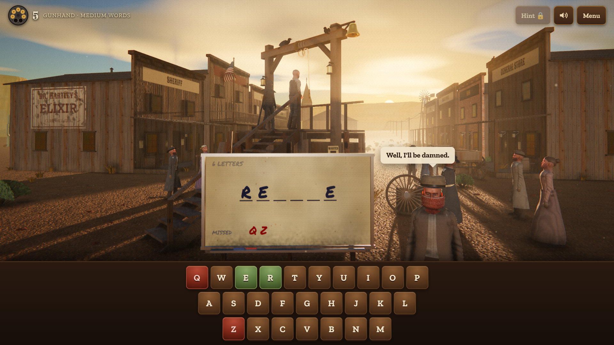
</p>

<table>
  <tr>
    <td align="center" width="33%">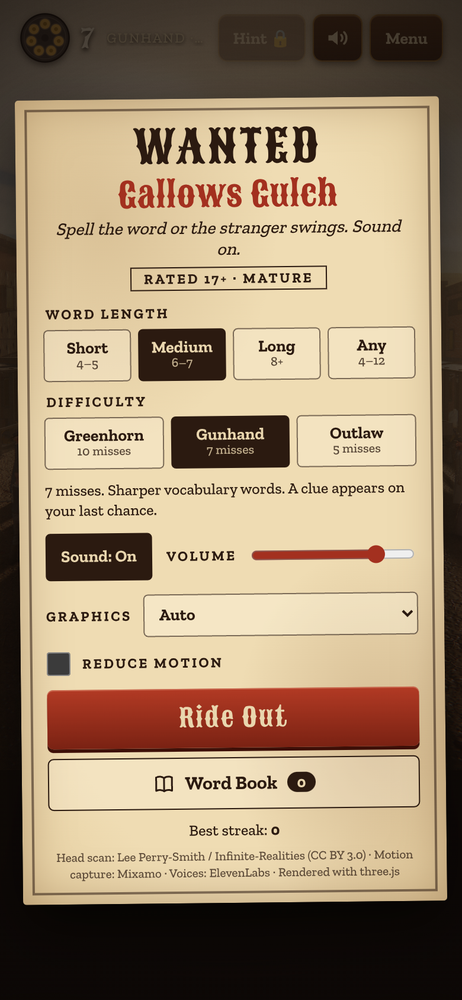<br><sub>The menu</sub></td>
    <td align="center" width="33%">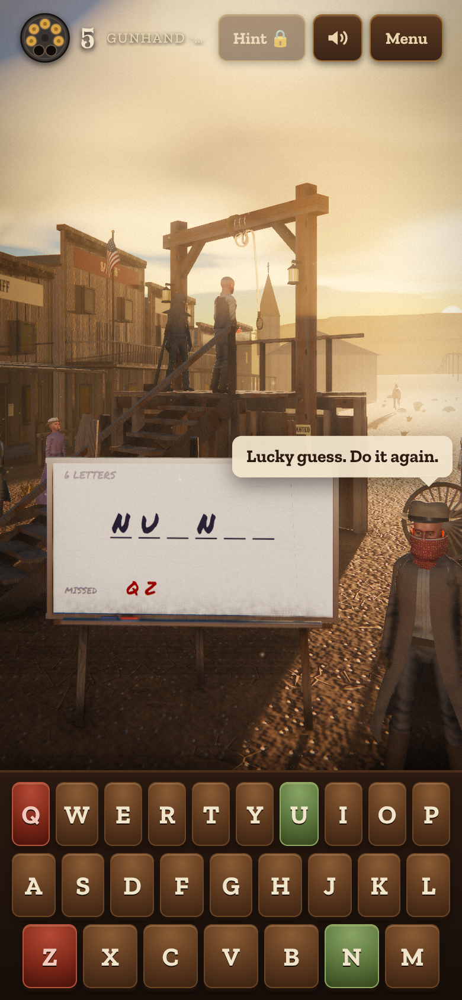<br><sub>A round under way</sub></td>
    <td align="center" width="33%">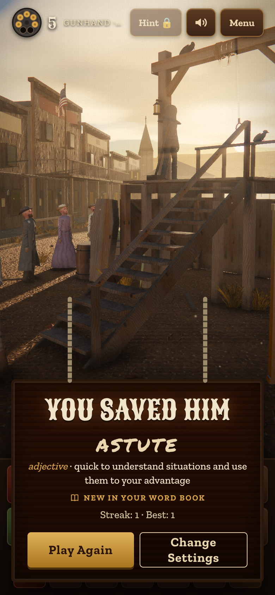<br><sub>Solved, with what the word means</sub></td>
  </tr>
  <tr>
    <td align="center">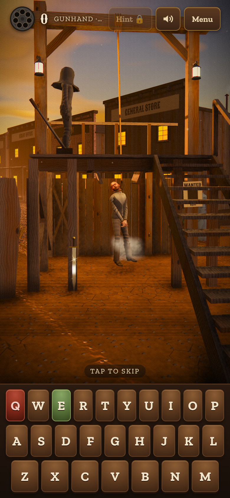<br><sub>He swings, and the sword glints</sub></td>
    <td align="center">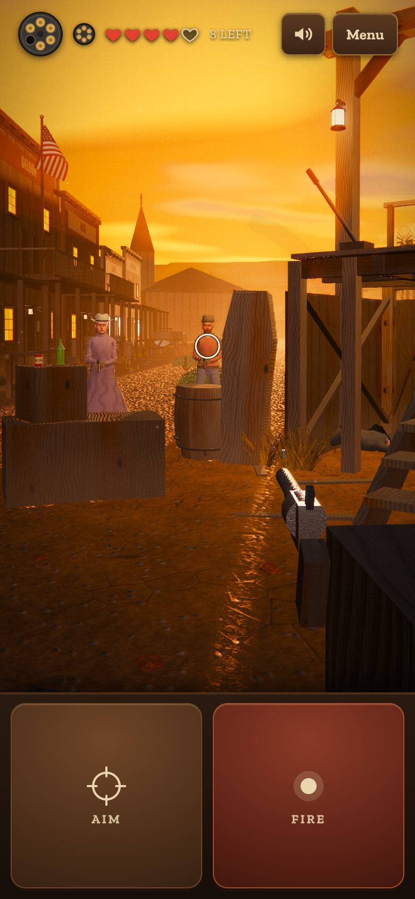<br><sub>The shootout</sub></td>
    <td align="center">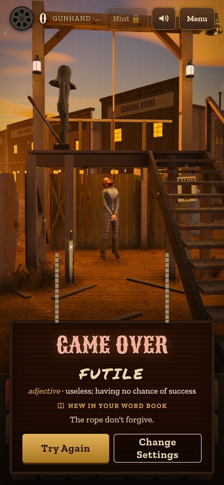<br><sub>Game over</sub></td>
  </tr>
  <tr>
    <td align="center">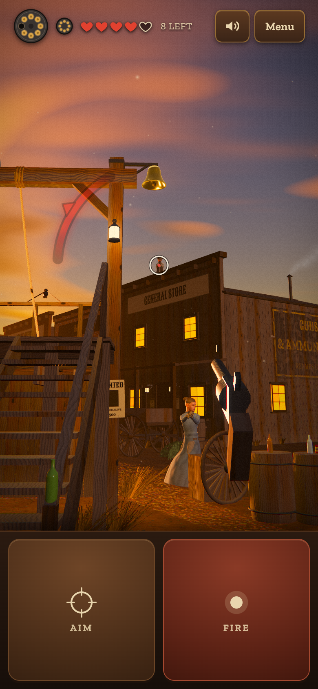<br><sub>Rooftop gunmen and the red arc</sub></td>
    <td align="center">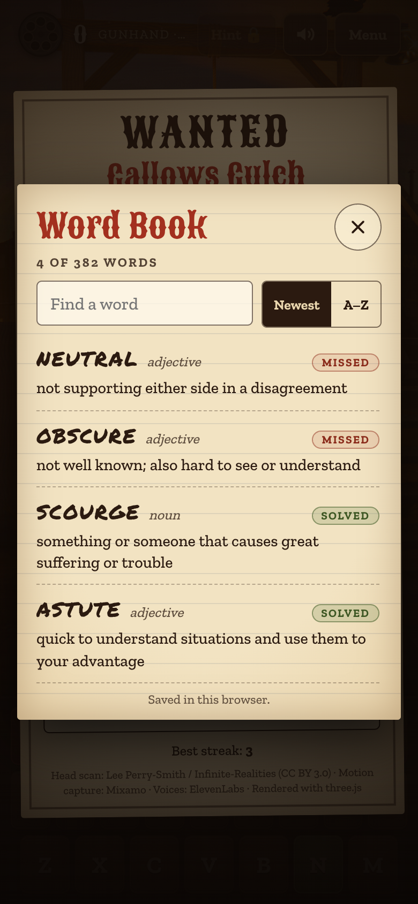<br><sub>The Word Book</sub></td>
    <td></td>
  </tr>
</table>

## How it plays

**The round.** A stranger stands condemned at the gallows, and the host calls your letters to the crowd. Each wrong
letter costs a bullet from the revolver at the top left and walks the man a step closer to the noose. Solve the word
and he goes free. On your last chance a clue appears at the top (except on Outlaw).

**Looking round.** Drag on the picture to turn your head: all the way round, up and down. Horses graze and wander at
the edge of town, some behind you. Each time the game cuts to a new view (a guess, the drop) you're turned back to it.

**Settings** (the WANTED poster menu):

| Word length | Letters |   | Difficulty | Misses | Words |
|---|---|---|---|---|---|
| Short | 4–5 | | Greenhorn | 10 | Familiar everyday words, a clue on your last chance |
| Medium | 6–7 | | Gunhand | 7 | Sharper vocabulary, a clue on your last chance |
| Long | 8+ | | Outlaw | 5 | Rare, high-level vocabulary, no hints |
| Any | 4–12 | | | | |

**When he hangs.** A sword glints, stuck in the ground under the gallows. Tap it within 4 seconds, or even after the GAME OVER sign comes
up, to cut him down and fight for the round.

**The revolver on the barrel.** Somewhere off to the side, out of the view the round ends on, a revolver lies on a
barrel, catching the light. Look round, find it and tap it, any time the host isn't busy (from the very start of a
round, or after you've saved him), and it's in your hand: the letters give way to an Aim and Fire pad and a **Put it
back** button. Drag to look round and shoot what you like; the crowd jumps at every shot. Shoot one of the townsfolk
or the executioner and the town turns on you: the shootout, right there, as the stranger, with no hangman to finish
and no rope to cut. The host and the condemned man aren't targets. Put it back and the round goes on.

**The shootout.** Now you're the stranger, behind cover, and nine gunmen are out for you: seven in the street and
two on the rooftops, behind the false fronts of the sheriff's office and the general store.
- Your revolver holds **8 rounds**, and you get **one reload**: 16 rounds in all. The reload is automatic: when the
  cylinder empties it refills by itself, and you can't fire until it's done. The speedloader beside the cylinder shows
  whether your reload is still there.
- You have **5 hearts**. Hearts you lose show as empty outlines.
- **Hold Aim** to rise up and drag to aim. **Fire** shoots. **Tap a piece of cover** to run to it.
  On a keyboard, hold **Shift** or **A** to rise and press **Space** or **Enter** to fire.
- You can turn all the way round and look from your boots to straight up: drag on the Aim pad, or drag on the picture
  (up or down behind cover). A quick drag turns you further than a slow one.
- While you're down behind cover, nobody can hit you. Once you're up, a gunman takes **0.3 s** to fire, and his
  hammer cocks just before he does. A red chevron marks the man taking aim.
- A gunman outside your view can take aim at you too, but he takes longer about it, and a **red arc** around the
  crosshair points toward him. Duck, or turn and take him first.
- The men on the roofs stand up at the false front to shoot and duck out of sight between shots. Hit one and he
  may pitch over the edge.
- They taunt you now and then. In the street they hide behind their own cover too: a trough, a crate stack and
  barrels.
- Run out of bullets with gunmen still standing and they know your gun is empty. They finish you off.
- Down all nine and you survive. The street stays yours, gun still in hand, until you press **Done**.
- There's a bell on the gallows. It's a target like any other, and it costs a bullet like any other.
- The street reacts to your shots. Bottles and tin cans stand on the gunmen's crates, barrels and trough and on the
  post at the foot of the gallows stairs: a bottle bursts into glass, a can jumps and can be shot again where it lands.
  The gallows lanterns shatter and go dark, shop windows crack round the hole, barrels and the trough's side spout
  water, the trough's water splashes, hay bursts into straw, iron throws sparks and the bullet whines off it, wood
  splinters and keeps the hole, the street spits dirt, and a tumbleweed jumps.
- Crows perch on the gallows, the rooftops and the hitching rails, and pick about in the street. Your shots and
  theirs scare them up. Hit one and it drops in a burst of blood and feathers and lies where it lands. Every bullet
  counts, as always.
- A loose horse bolts across the street past the gallows during the fight, and the town's other horses are about:
  one tied at the rail by the trough, others grazing and wandering at the edges, some behind you. Shoot one and it
  goes down.
- Most of what's lying about can be shot to pieces: crates, barrels, the coffin, the trough and hitching rail, the
  wagon wheel, the benches, sacks, lanterns, shutters and posters on the porches, and the gunmen's own cover. Each
  takes a few bullets; whatever was on it falls, and a gunman whose cover is gone is in the open.
- Look down at the crate by your left hip at your middle cover. There's a laser on it, and you can tap it to take it
  up at any time (if the revolver runs dry first it wakes up humming). **Hold Fire** for a blue beam: a man in it
  burns to ash and crumbles into a little heap, and it scorches and breaks what it touches. It holds **20 seconds**
  of firing (the blue ring where the cylinder was), then takes **7 seconds** to charge itself (the ring fills amber).
  What it does to a horse or a crow is best seen, and what that leaves on the ground burns to ash in the beam too.
- Taking the laser leaves your revolver on the crate. Tap the revolver to swap back (the laser keeps its charge on
  the crate), and swap again whenever you like. Whichever you're holding when the street's cleared is the gun you
  take into the getaway.

<details>
<summary><b>Spoiler: the getaway</b> (what the bell is for)</summary>

<br>

<table>
  <tr>
    <td align="center" width="33%">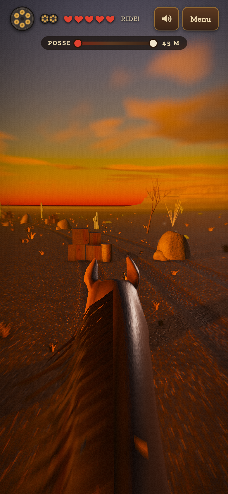<br><sub>The run</sub></td>
    <td align="center" width="33%">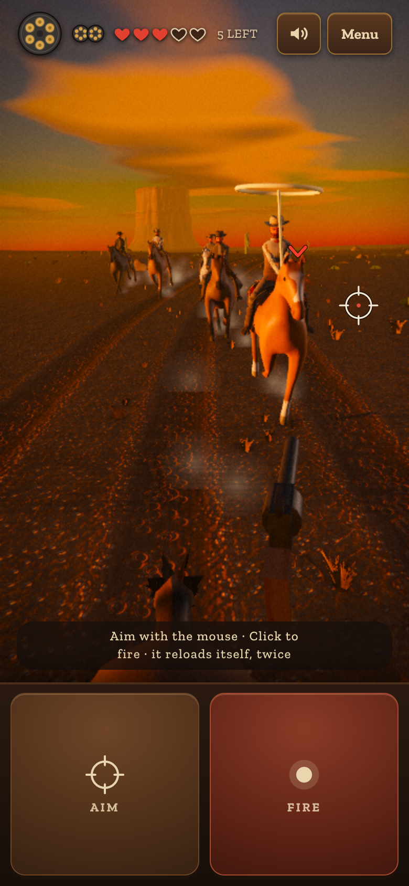<br><sub>The fight</sub></td>
    <td align="center" width="33%">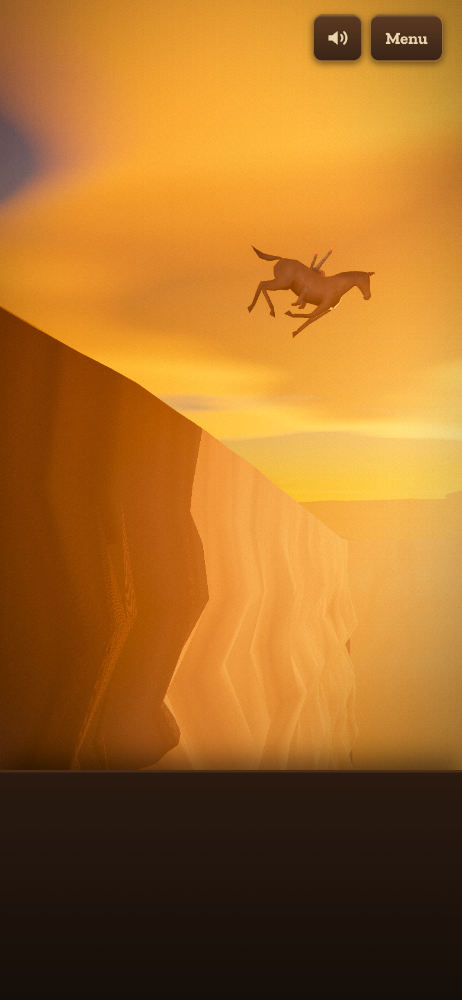<br><sub>Should've watched the road</sub></td>
  </tr>
</table>

Shoot the bell during a shootout and the round is marked. Nothing else changes: the fight goes on, and the bullet
counts. Then:
- **Win, having rung it.** "You survived" flashes up, the posse comes down the street, you get on a horse and ride.
  It doesn't matter if your gun is empty by then.
- **Win without ringing it.** The street stays live, and you can still shoot the bell (if you have a bullet left).
  Ring it then and you ride.
- **Lose, having rung it.** Nothing happens. A new shootout starts the bell over.

**First half, the run.** Three horse trails side by side, worn into the dirt and cut up with old hoofprints, with dry
grass between them. Nothing on the screen to press.
- **Swipe left or right** anywhere to change lane, one lane per swipe. **Swipe up** to jump. On a keyboard: **← / →**
  or **A / D** for a lane, **↑**, **W** or **Space** to jump.
- Boulders, stands of saguaro, stacked freight and wagons (a wagon fills its lane for a while) have to be gone round.
  Logs, hay bales, troughs and fences can be jumped; sometimes a fence runs right across the trail. Every row has a
  way through, and every course can be ridden clean: `test/scenarios/mk_s134.py` searches 300 of them frame by frame
  to prove it.
- It's flat out from the first stride, and the rows come quicker and harder to read as it goes. The edges of the view
  blur with the speed.
- A swipe every row: whatever lane you came through one row in, the next row blocks it with something you can't
  jump, so every row makes you move left or right (and some make you jump as well).
- Ride into something and the horse shies off it into an open lane; trip over something low and you stumble; clip
  something changing lane and you're bounced back. Each costs ground, and the posse gains.
- The bar at the top shows how close they are. Once they're close they shoot at you (dirt kicks up ahead) and the
  screen's edges pulse red. Let them catch you and you're captured.

**The turn.** Halfway, a shot whistles past your shoulder. You twist round in the saddle and draw. The horse goes on
the same way, keeping to the trail, and nobody can hurt you while you turn.

**Second half, the fight.**
- It's the same gun and the same hearts as the shootout, but out here it holds 6 rounds and you get two automatic
  reloads: 18 rounds in all. A speedloader for each sits beside the cylinder.
- Aim with the mouse, by dragging the **Aim** pad (as in the shootout) or by dragging on the view. Any of these works
  while another finger holds **Fire**. **Click** or **Fire** shoots.
- When the cylinder empties it reloads by itself, twice. Run dry with riders still coming and they ride in and finish
  you.
- If the laser was in your hand when the street was cleared, you ride out with it instead: hold **Fire** (or the mouse
  button, or Space) for the beam, 20 seconds of it, then 7 to recharge. A rider in it burns to ash in the saddle and
  his horse runs on without him; a horse in it is a steak, and its rider goes into the dirt.
- The horse swerves round things on its own. Each swerve pulls your aim to one side, so watch the reticle and fire in
  the steady spells. Shots go exactly where the reticle is.
- Gunmen hang back and take aim. Lasso men ride in close and spin a loop. The last rider comes up close and takes two
  hits. They all keep where you can see them, even on a phone held upright.
- A red mark shows who's about to attack, and the red arc points to anyone attacking from off the screen. Hit a man
  while he winds up and he loses the attack.
- Shoot a rider's horse and it goes down, throwing him; he's out of the fight.
- Lose all five hearts and you're captured.

**The end.** Drop the last rider and you've won. What happens next is a short, letterboxed scene you can't control,
filmed in a few shots. You can skip it after the first time. Then **Retry chase** (straight back in the saddle) or
**Return to Hangman**.

The run takes about 55 seconds and the fight about 20–40, depending on your shooting. The run's numbers (lanes,
speeds, jumps, the course, what a hit costs) are in `RUN` at the top of `src/12h_runner.js`; the fight's and the
posse's in `CHASE_CFG` at the top of `src/12g_chase.js`; the canyon and the shots of the end in `CANYON` and `CINE` in
`src/12i_canyon.js`. The gun and the hearts are in `GUN` at the top of `src/12d_siege.js` (the town shootout's eight rounds in `SIEGE_ROUNDS`), and the laser's charge
and recharge in `LASER_CFG` at the top of `src/12k_laser.js`.

</details>

**The Word Book.** Every finished word goes in your book with its part of speech, its meaning, and whether you
solved or missed it. Open it from the menu, then search it or sort it by newest or A–Z. It's saved in your browser.
When the game runs as a claude.ai artifact it's also saved to your account, so it follows you between devices.

The menu's big button reads **Ride Out** the first time you open it, **Restart** during a game, and **Try Again**
or **Play Again** after one ends.

## Features

- A whole frontier town at golden hour: false-front buildings, a church spire, mesas, a working gallows with a
  simulated rope, trapdoor and lever, dust, tumbleweeds, circling vultures and a horse that sometimes bolts down the
  street. Crows hop about on the gallows and the rooftops, call to one another and fly off when something startles them.
- Lived-in detail: porches with lanterns that light at dusk, benches, shutters, crates, sacks and barrels, wanted
  posters with their own faces and prices, and the street littered with stones, broken boards, bottles, cans and
  horseshoes. Close up, the ground has grit and little stones and the timber has fibres and splinters.
- Townsfolk built from one motion-captured body and a 3D head scan. Clothes, hats, hair and faces are fitted in
  code, and the bodies turn into ragdolls when they fall.
- A spoken host: 42 recorded lines, with matching subtitles, that react to every letter. Plus gunmen's taunts and
  positional sound effects.
- A looping soundtrack that brightens as the noose gets closer. Footsteps, wind and a crowd murmur are synthesized
  live. The crows' calls are real crows, strung into calls as the game goes, with a quiet spell after each.
- 382 vocabulary words, each with a definition written for the game.
- Graphics tiers (Fast, Balanced, High, Ultra, or Auto). Auto starts phones on High and computers on Ultra, and steps
  down by itself if frames run long. High adds bloom, soft shadows, ambient occlusion, light shafts, volumetric light,
  skin shading and close-up detail textures; Ultra doubles the texture resolution and the sun's shadow map and adds
  more of everything.
- Built for touch, with safe-area insets for notched phones, sound that plays even with an iPhone's ring/silent
  switch on (there's a mute button), and keyboard play on desktop. A **Reduce motion** setting cuts camera shake.
- Something hidden, for anyone who rings the bell.

## Run it

You need Python 3 and nothing else.

```sh
python3 build.py                        # writes dist/ (about a second)
python3 -m http.server 8000             # serve the repo
# open http://localhost:8000/dist/
```

The page must be served over HTTP. Opening `dist/index.html` straight from disk won't load the models and sounds.
three.js r147 and the fonts come from CDNs, so the first load needs internet.

### Put it online with GitHub Pages

The workflow in `.github/workflows/pages.yml` builds the game and publishes `dist/` on every push to `main`. To turn
it on, go to **Settings → Pages → Build and deployment → Source** and choose **GitHub Actions**, then push or re-run
the workflow. Until Pages is on, the workflow only builds and checks the game. On a free GitHub plan, Pages needs a
public repository.

## Project layout

```
build.py                 builds dist/ from src/ and assets/ (standard library only)
src/                     the game: one HTML shell and 37 JavaScript modules, loaded in the order build.py lists
  00_head.html           page markup and all CSS: HUD, keyboard, menu poster, end sign, Word Book, the getaway's HUD
  01_util.js             helpers, seeded noise
  02_textures.js         procedural material textures and sprites
  03_audio.js            Web Audio: soundtrack, voice, 3D sound effects, synthesized ambience
  04_render.js           renderer, graphics tiers, post-processing, shaders
  05_sky.js              physically based sky and sun
  06_world.js            desert terrain, mesas, rocks, cacti, scrub and the frontier town
  07_props.js            the gallows (trapdoor, lever, rope and noose), the word board, set dressing
  07c_dressing.js        porch props, wanted posters, the street's litter, tumbleweeds rolling through
  07b_physics.js         wind, the rope simulation, the swinging trapdoor leaves and lanterns
  08a_bodygeo.js         clothing built around the mocap skeleton
  08b_chars.js           character assembly: rig, clothes, scanned head, hats, hood, mask
  08c_headdata.js        baked occlusion data for the head scan
  09_anim.js             walking, mocap blending, look-at, IK, the hanging body
  09b_ragdoll.js         ragdolls
  10_life.js             horse, vultures, tumbleweed, dust, townsfolk
  10b_horse.js           horses up close: a smoother body, the back measured as it gallops, the coat (hair, points,
                         socks, blaze, dapples), saddle, a mane of hair that lies on the neck, tail, reins
  10c_crows.js           the crows: perching, hopping, calling, flying, startled, shot, falling; feathers
  11_words.js            the word bank with clues, and the host's lines
  11b_defs.js            a plain-English meaning for every word
  12a_director.js        game state, camera, cutscenes
  12b_game.js            rounds: guessing, winning, losing, the end sign
  12b2_play.js           grabbing the hanged man
  12d_siege.js           the sword, the cut-down and the shootout
  12e_book.js            the Word Book
  12f_bell.js            the bell, and the cleared street after a win
  12j_targets.js         what the shootout's shots do: bottles, cans, lanterns, windows, water, straw, sparks, dirt, holes
  12k_laser.js           the laser gun: on the crate, taken up (the revolver left there to swap back), the beam, the charge, its ring
  12l_meat.js            horses shot down (in town and in the getaway); the laser's flash, the steak (drawn on canvases) and chicken legs
  12m_break.js           the things that break: tagged as the town is built, merged, hidden in the shader when shot apart
  12n_herd.js            the town's horses: tied, grazing, walking (a standing horse made from the gallop: 10b)
  12o_ash.js             a man (or a rider, or meat on the ground) in the laser's beam burning to ash, and the heap left
  12p_look.js            looking round in the hangman part; the revolver on the barrel, shining
  12q_armed.js           the revolver from the barrel in your hand before any shootout; shoot a townsman and the shootout starts
  12g_chase.js           the getaway: posse, horses, the turn, the fight, the results
  12h_runner.js          the getaway's run: three lanes, swipes and jumps, the course, the desert along the trail
  12i_canyon.js          the canyon at the end and the filmed fall
  12c_boot.js            loading, menu, input, main loop
assets/
  models/                Xbot.glb, LeePerrySmith.glb, Horse.glb, Stork.glb, ARC09.glb (the laser gun)
  textures/              the head scan's colour, normal and specular maps
  audio/                 soundtrack.mp3, silence.mp3, voice/ (43 host lines), sfx/ (74 effects, taunts, shouts and the crows)
vendor/three-r147/       the nine three.js r147 files the game uses, for offline tests (MIT)
tools/
  check_build.py         checks the bundled script parses and every file the code asks for is in dist/
  asset_report.py        measures every asset and writes ASSETS.md
  pack_arc09.py          packs the laser gun's source GLB for the game: quantized meshes, smaller textures (NumPy, Pillow)
test/                    browser test harness (Playwright): see test/README.md
docs/screenshots/        the pictures above
```

More detail:
- [ASSETS.md](ASSETS.md) lists every model, texture and sound with its size, pixels, length, sample rate and bit
  rate, and what each voice line says.
- [CREDITS.md](CREDITS.md) says where each asset came from and its licence.
- [CHANGELOG.md](CHANGELOG.md) has the version history.

## Development

- Edit `src/`, then run `python3 build.py`. `python3 tools/check_build.py` checks the result (it needs Node.js).
- `test/game.html`, written by the build, loads each module separately with three.js from `vendor/`. This makes errors
  point at the right file.
- The test harness drives the game in headless Chromium with software WebGL and can play whole rounds faster than
  real time. See [test/README.md](test/README.md).
- Change an asset, then run `python3 tools/asset_report.py` (needs Pillow and FFmpeg) to refresh ASSETS.md.
- `python3 build.py --fragment` writes the page without its `<!doctype>`/`<head>` skeleton, for a host that adds its
  own, such as claude.ai artifacts.

## Credits

Built with [three.js](https://threejs.org). Head scan: Lee Perry-Smith by Infinite-Realities (CC BY 3.0).
Motion capture: Mixamo. Voices and sound effects: ElevenLabs; the neck snap and the crows were recorded by the
repository owner. The laser gun (ARC-09) was modelled by the repository owner with Claude. Music: "Eagle's Caw", made with Suno.
Fonts: Sancreek, Zilla Slab and Permanent Marker, from Google Fonts. Full details and licences are in
[CREDITS.md](CREDITS.md).

## License

No licence has been chosen for the game's own code yet, so for now all rights are reserved by the repository owner.
The third-party assets keep their own licences, listed in [CREDITS.md](CREDITS.md).
